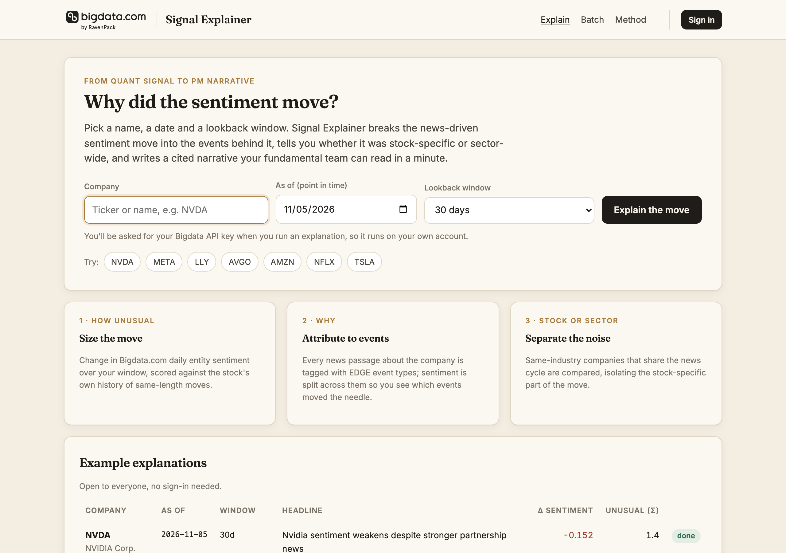
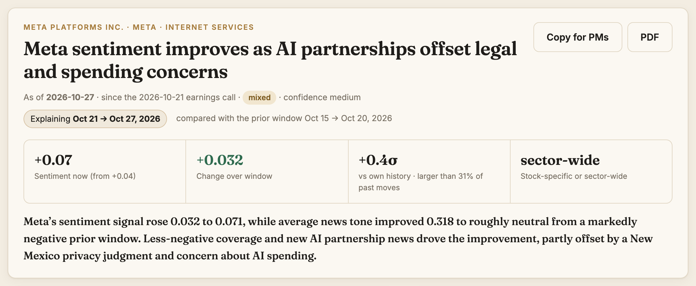
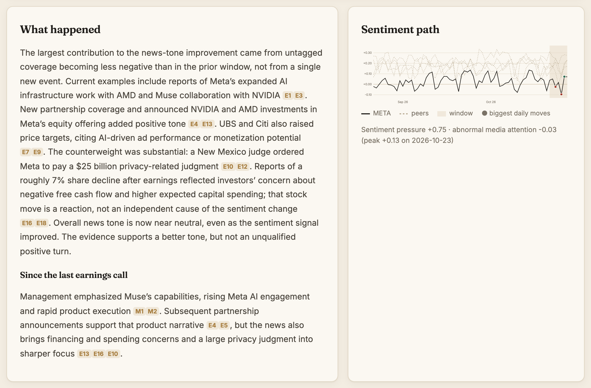
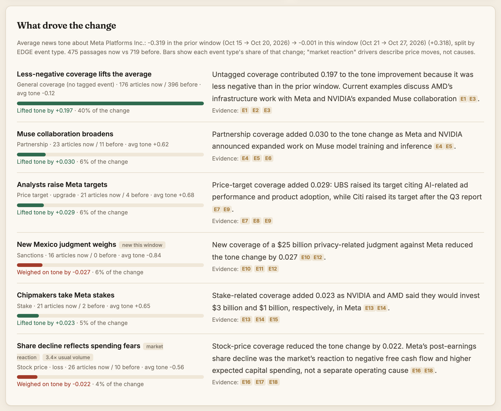
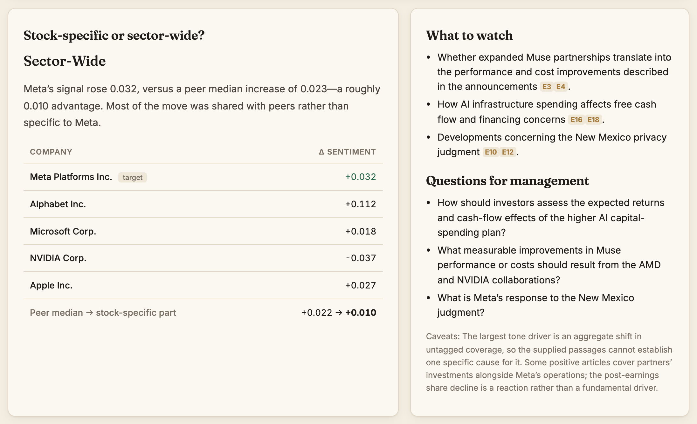
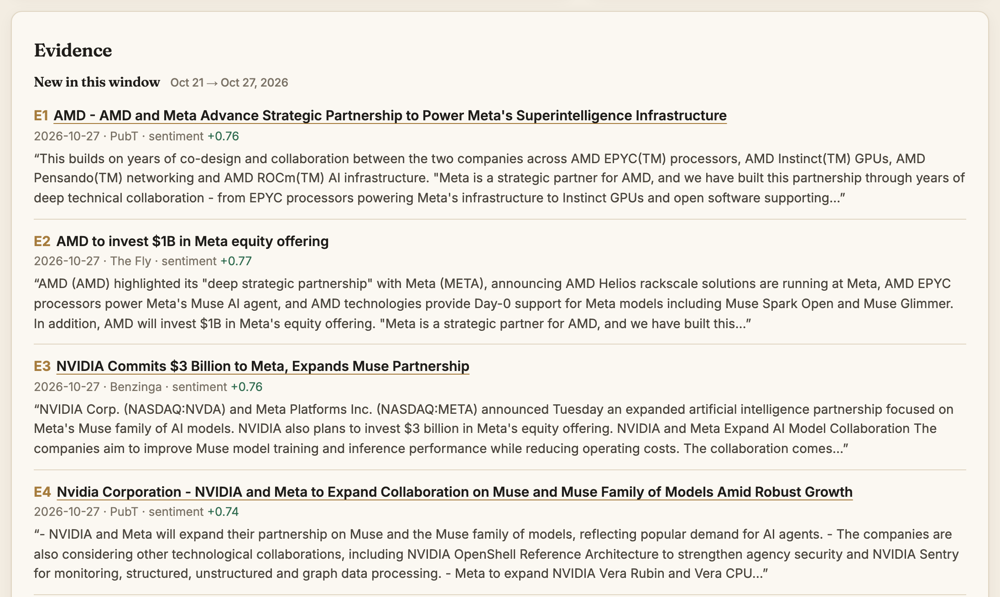
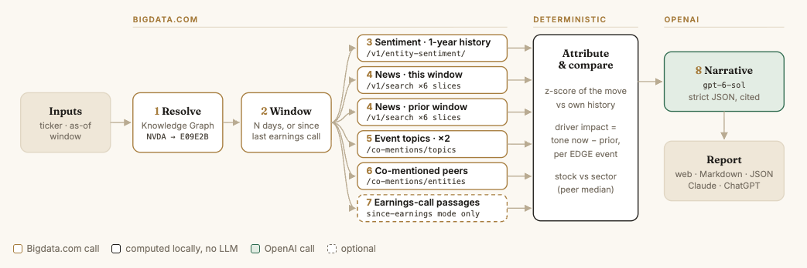

# Bigdata Signal Explainer

> **Why did the sentiment move?** Turn a quant sentiment signal into a cited narrative a fundamental PM can read in a minute. Powered by [Bigdata.com](https://bigdata.com).

Give it a company, a point-in-time date and a lookback window (or "since the last earnings call"). It sizes the move, attributes it to news events, separates stock-specific from sector-wide moves, and writes a narrative in which every claim cites its source.



## Contents

- [Walkthrough: Meta since its Q3 earnings call](#walkthrough-meta-since-its-q3-earnings-call)
- [How it works](#how-it-works)
- [Quick start](#quick-start)
- [Configuration](#configuration)
- [Ways to use it](#ways-to-use-it)
- [API](#api)
- [Repository layout](#repository-layout)

## Walkthrough: Meta since its Q3 earnings call

The screenshots below come from a public example run: **META**, as of **2026-10-27**, in *since earnings* mode (Oct 21 → Oct 27, compared with the prior window Oct 15 → Oct 20).

### 1. The answer up front

The headline, the four numbers that matter, and a one-paragraph summary:

- **Sentiment now** and where it came from.
- **Change over the window.**
- **How unusual the move is:** a z-score against the stock's own history of moves of the same length.
- **Stock-specific or sector-wide.**



### 2. What happened, and the sentiment path

The narrative explains the move. Every claim is tagged with evidence (`E1`, `E2`, …) or management quotes (`M1`, …). In *since earnings* mode it also compares what management said on the call with what the news says now. The chart shows the stock's sentiment against peers and flags the biggest daily moves.



### 3. What drove the change

News passages that mention the company are tagged with **EDGE event types**. The change in average news tone against the prior window is split across those event types, so the impacts add up to the total. Price and index chatter is flagged as *market reaction*, and stories that faded are cited from the prior window.



### 4. Stock-specific or sector-wide?

Co-mentioned public companies in the same industry group give a peer median. Whatever the peer median doesn't explain is the stock-specific part. The run ends with what to watch and questions for management.



### 5. Evidence

Every cited passage comes with its date, source, sentiment and a link to the document on Bigdata.com. Nothing published after the as-of date is used.



Every run can also be copied as PM-ready Markdown (for email, ChatGPT or Claude) or saved as a PDF.

## How it works



Each run takes about 20–40 seconds:

1. **Resolve** the ticker to a company in the Bigdata.com Knowledge Graph.
2. **Set the window:** the last N days, or the time since the last earnings call.
3. **Fetch from Bigdata.com in parallel:**
   - the entity-sentiment series, with one year of history (`/v1/entity-sentiment/`)
   - news passages for this window and the prior window of equal length, each split into 6 search slices (`/v1/search`)
   - event topics for both windows (`/v1/search/co-mentions/topics`)
   - co-mentioned peer companies (`/v1/search/co-mentions/entities`)
   - earnings-call passages, in *since earnings* mode only
4. **Attribute and compare,** computed locally with no LLM:
   - the z-score of the move against the stock's own history
   - each EDGE event type's impact on the change in tone
   - the stock-specific part of the move, against the peer median
5. **Narrate** with OpenAI (`gpt-6-sol`) under a strict JSON schema. Every claim cites evidence, and nothing after the as-of date is used.
6. **Report** the run in the web UI, as Markdown and JSON, and through the Claude and ChatGPT integrations. Runs are stored in SQLite.

## Quick start

Requires Python 3.11+ and [uv](https://docs.astral.sh/uv/) (or plain `pip`).

```bash
cd signal-explainer
uv venv --python 3.12 .venv && uv pip install -r requirements.txt
cp .env.example .env          # set OPENAI_API_KEY and APP_SECRET
.venv/bin/uvicorn app.main:app --port 8077
```

Open <http://localhost:8077> and sign in with your Bigdata API key. The **Method** page lists every Bigdata.com and OpenAI call a run makes.

Run the tests:

```bash
cd signal-explainer && PYTHONPATH=. .venv/bin/pytest -q tests
```

## Configuration

Settings are read from `signal-explainer/.env` (see `.env.example`).

| Variable | Default | Purpose |
|---|---|---|
| `OPENAI_API_KEY` | *(empty)* | Writes the narrative. Without it, the app uses a deterministic template narrative. |
| `OPENAI_MODEL` | `gpt-6-sol` | Also `gpt-6-luna`, `gpt-6.1-sol`. |
| `APP_SECRET` | *(empty)* | Fernet key that encrypts the sign-in cookie. If it's empty, everyone has to sign in again after a restart. |
| `COOKIE_SECURE` | `true` | Keep `true` behind HTTPS (browsers also accept it on localhost). |
| `SESSION_HOURS` | `12` | How long a sign-in lasts. |
| `DB_PATH` | `./data/app.db` | SQLite file for users, runs, batches, and the entity and API-response cache. |
| `BIGDATA_API_KEY` | *(empty)* | Optional. Runs created before sign-in existed are given to this key's user. |

Generate `APP_SECRET` once:

```bash
python -c "from cryptography.fernet import Fernet; print(Fernet.generate_key().decode())"
```

**Users and keys.** Everyone signs in with their own Bigdata API key, so Bigdata.com usage is billed to their own account, and they see only their own runs and batches. The web UI keeps the key encrypted in an HttpOnly cookie. API callers send it as `Authorization: Bearer <key>`. The server never stores the key: users are identified by a fingerprint of it.

**Caching.** Bigdata.com responses for windows that end before today are cached, so re-running a past date costs nothing and reproduces the same inputs.

## Ways to use it

| Surface | How |
|---|---|
| **Web UI** | Explain a single name, or upload a batch CSV and get the names ranked by how unusual each move is. |
| **JSON API** | See [API](#api) below. |
| **Claude skill** | Copy `skills/claude/explain-sentiment/` to `~/.claude/skills/`. It calls this app when `SIGNAL_EXPLAINER_URL` is set, and otherwise uses the Bigdata.com MCP connector alone. |
| **ChatGPT GPT** | Use `skills/chatgpt/gpt-instructions.md` as the instructions and `openapi.json` for GPT Actions. ChatGPT needs a public HTTPS URL for the app. |

## API

Every `/api/*` call needs `Authorization: Bearer <Bigdata API key>` and only sees that key's runs.

| Endpoint | Description |
|---|---|
| `POST /api/explain` | `{ticker, as_of?, lookback_days=30, mode: lookback\|since_earnings, input_score?, wait_seconds=40}` → narrative, drivers, evidence, `markdown`, `report_url` |
| `GET /api/runs/{id}` | Poll a run. |
| `POST /api/batch` | `{tickers[], as_of?, lookback_days, mode}` → `batch_id` |
| `GET /api/batches/{id}` | A batch's runs, ranked by how unusual each move is. |
| `GET /runs/{id}/markdown` | The PM-ready Markdown. |

## Repository layout

```
.
├── signal-explainer/        FastAPI + Jinja web app and JSON API
│   ├── app/                 pipeline, Bigdata.com client, narrator, templates
│   ├── tests/
│   ├── .env.example
│   ├── pyproject.toml
│   └── requirements.txt
├── skills/
│   ├── claude/explain-sentiment/   Claude skill (+ example output)
│   └── chatgpt/                    GPT instructions + OpenAPI spec for Actions
└── docs/screenshots/        images used in this README
```

---

Data: [Bigdata.com](https://bigdata.com) entity sentiment, news analytics and the EDGE event taxonomy. Narratives are generated from cited passages only. Not investment advice.
